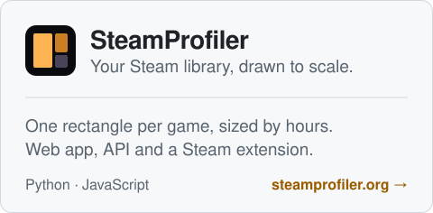
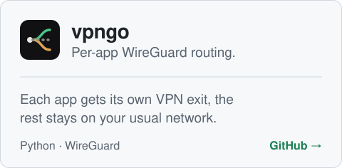
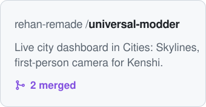
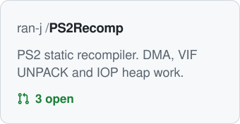
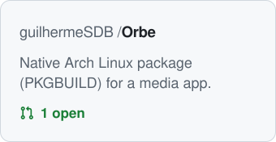

<div align="center">

<p><picture>
  <source media="(prefers-color-scheme: dark)" srcset="assets/header-dark.svg">
  
</picture></p>

<p>
  <a href="https://gcruz.geg.dev.br">Website</a> ·
  <a href="https://www.linkedin.com/in/gusttavocruz/">LinkedIn</a> ·
  <a href="mailto:gustavo_cruz08@hotmail.com?subject=Contact%20from%20GitHub">Email</a> ·
  <a href="https://calendly.com/gustavo_cruz08">Book a call</a>
</p>

Nine years in tech, five of them building software. At DXC I own the maintenance and evolution of critical systems for a large logistics operator, from the business rule all the way to production. Before development I spent four years in infrastructure, so I care about what happens after the deploy.

### Building

<p>
  <a href="https://steamprofiler.org"><picture>
    <source media="(prefers-color-scheme: dark)" srcset="assets/steamprofiler-dark.svg">
    
  </picture></a>
  <a href="https://github.com/GustavoHSCruz/VPNGo"><picture>
    <source media="(prefers-color-scheme: dark)" srcset="assets/vpngo-dark.svg">
    
  </picture></a>
</p>

### Contributing

<p>
  <a href="https://github.com/rehan-remade/universal-modder/pulls?q=is%3Apr+author%3AGustavoHSCruz"><picture>
    <source media="(prefers-color-scheme: dark)" srcset="assets/contrib-modder-dark.svg">
    
  </picture></a>
  <a href="https://github.com/ran-j/PS2Recomp/pulls?q=is%3Apr+author%3AGustavoHSCruz"><picture>
    <source media="(prefers-color-scheme: dark)" srcset="assets/contrib-ps2recomp-dark.svg">
    
  </picture></a>
  <a href="https://github.com/guilhermeSDB/Orbe/pull/1"><picture>
    <source media="(prefers-color-scheme: dark)" srcset="assets/contrib-orbe-dark.svg">
    
  </picture></a>
</p>

### Stack


### This week

<!--START_SECTION:waka-->

```txt
Total Time: 15 hrs 55 mins

Markdown                   4 hrs 26 mins   ██████░░░░░░░░░░░░░░░░░░░   24.05 %
JavaScript                 4 hrs 9 mins    █████▓░░░░░░░░░░░░░░░░░░░   22.49 %
Python                     3 hrs 54 mins   █████▒░░░░░░░░░░░░░░░░░░░   21.13 %
Other                      2 hrs 34 mins   ███▒░░░░░░░░░░░░░░░░░░░░░   13.88 %
Lua                        46 mins         █░░░░░░░░░░░░░░░░░░░░░░░░   04.21 %
Razor                      28 mins         ▓░░░░░░░░░░░░░░░░░░░░░░░░   02.56 %
```

<!--END_SECTION:waka-->

</div>
